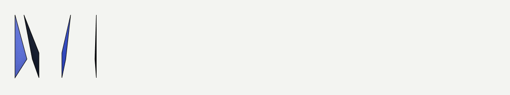
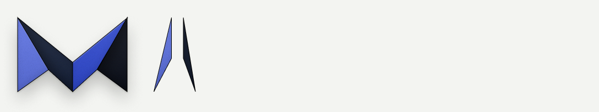
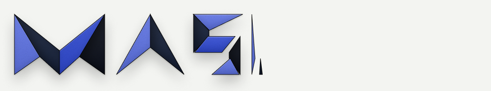
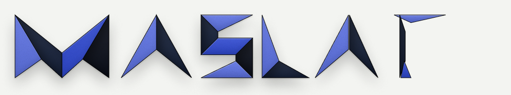
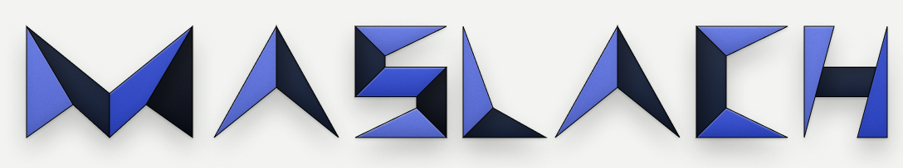

# The look

The house look as a themable style: sharp facets, two-tone print, one light, shadows that do the
work. Written 2026-11-02 from the Maslach logo in Figma (file `4dCOuFddrSlSROuULc5Rl1`, page
"new logo", read through the Figma MCP server with the SVG exports of the quoted nodes read as
text) and its seed port (the seed's `OrigamiWord.vue` and `OrigamiUnfold.vue`).
The logo supplies the reference values; the default style is the logo's own "Paper light"
variant, a neutral paper. Nothing in `src/` names the site: a host passes its style in. The
rendering rule behind each field is in `docs/study/02-paper-on-a-screen.md` (cited as "02").

## The `Style`

Field by field; the type is a spec for doc 02, not code.

```
Style
  tones
    lit:   [Tone, Tone]      the two lit slots, alternating along a strip
    shade: [Tone, Tone]      the two shade slots
    back:  Tone              the unprinted side; defaults to the host's sheet color
  crease
    width: px                hairline width (1)
    onLit: color             hairline on a lit face
    onShade: color           hairline on a shaded face
    gradient
      strength: 0..1         darkening at the hinge of a shade face
      depth: 0..1            how far into the face it reaches (fraction of hinge-to-centroid)
      occlusion: 0..1        the per-frame extra at the crease as the angle nears 180 (02, cue 8)
  grain
    on: boolean
    strength: 0..1           alpha of the multiplied noise
    frequency: number        feTurbulence baseFrequency
    octaves: number
  shadows
    contact: { offset: [x, y], blur, opacity, fade: px }           gone by `fade` px of lift
    ambient: { offset: [x, y], blur, spread, opacity,
               lift: { offset: [x, y] per px, blur: px per px, opacity: fraction at 300 px } }
  edges: 'sharp'             the only value in the first release
  light
    direction: [x, y, z]     unit, page coordinates, toward the light
    ambient: number          ka
    diffuse: number          kd
  thin: boolean              content shows mirrored through the back (default false)

Tone = { top: color, bottom: color }   a top-to-bottom gradient; a single color is both
```

A face's print is its slot's `Tone`; its displayed tone is that print times the Lambert factor
`ka + kd * max(0, L . N)` (02, cue 1), which is 1 for a flat face, so the resting pose shows the
four tones exactly.

## The reference: the Maslach logo

Node ids are on the "new logo" page. The `Origami M` component (11:60) is "a paper strip folded
into the M. Four facets, one light source (upper left). Shadows and grain are effects, so any
instance recolors by its four facet fills" (lede, 11:62). Values below are from the SVG export of
the Brand instance (11:63, inside "01 — Colors" 11:127) and of the K2 letters (24:293, 24:298),
which carry the same effects at full scale. Figma's effect "blur" exports as `stdDeviation =
blur / 2`; the blur values below are Figma's, in the component's own units (letters 270 tall,
the seed's `origami.ts`), with the CSS equivalent in brackets.

**Tones** (the four facet fills, top to bottom gradients; the seed's flat tokens in brackets):

| slot | facet | top | bottom | seed token |
|---|---|---|---|---|
| lit 1 | leg-left | `#6D80E6` | `#5467CC` | `--ori-1: #5d72e3` |
| shade 1 | fold-left | `#2D374E` | `#141E34` | `--ori-2: #16213a` |
| lit 2 | fold-right | `#445BD6` | `#2A42BC` | `--ori-3: #2f49d1` |
| shade 2 | leg-right | `#232731` | `#0A0E17` | `--ori-4: #0b0f1a` |

The seed paints the flat token and lays a light gradient over it (white 0.22 at the top to
black 0.12 at the bottom, `OrigamiWord.vue`); the Figma fill is the gradient itself. Both read
the same; the style stores the gradient.

**Light on the faces** (inner effects per facet, node 11:63; the same on 24:293 and 24:298):

- lit faces: an inner highlight `dy 2, blur 2, white at .5` (a lit top edge under the crease)
  and an inner shadow `dy -6, blur 14, black at .1` (the bottom falls into shade).
- shade faces: an inner shadow `dx 12, dy 4, blur 22, black at .38` offset away from the hinge
  (the crease gradient, 02 cue 8; the seed draws it as a linear gradient from the hinge midpoint
  toward the centroid, black .46 to .1 at 60 percent to .18, over 2.2 times that distance) and a
  dark edge `dx -2, blur 2, black at .2` along the hinge.

**Crease hairline.** The seed: `1.5 px` on a 270-unit letter, black at .3 on a lit face, white at
.4 on a shaded face, on every non-root facet's hinge (`OrigamiWord.vue`). The Figma keyframes
(18:319 to 18:455) stroke every face edge `black, 1 unit` instead; that is the keyframe drawing's
convention, and the style keeps the seed's values at 1 px.

**Grain.** Figma: `feTurbulence fractalNoise, baseFrequency 1.0, numOctaves 3`, through a
discrete alpha mask, black at .14, on every facet (11:63 export; the "01 — Colors" instances are
drawn at 0.6 scale, where the same grain exports as frequency 1.67). The seed:
`baseFrequency .85, numOctaves 2`, alpha 0 to .16, multiplied (`--ori-grain`).

**Shadows** (the stack under the whole lockup, 11:63 and every letter of the keyframes):

| layer | offset | blur | spread | opacity | CSS |
|---|---|---|---|---|---|
| ambient | `0, 16` | 32 | -6 | .22 | `drop-shadow(0 16px 16px rgb(0 0 0 / .22))` with the spread by a `-6` morphology, or `box-shadow: 0 16px 32px -6px` on a rectangle |
| contact | `0, 2` | 4 | 0 | .14 | `drop-shadow(0 2px 2px rgb(0 0 0 / .14))` |

The seed's values differ slightly (`dy 14 blur 28 at .2` and `dy 2 blur 4 at .16`,
`OrigamiWord.vue`); the Figma stack is the reference. The three.js scene's shadow floor at
opacity .22 (`OrigamiUnfold3D.vue`) matches the ambient layer.

**The "Paper light" variant** (11:95 inside 11:100; "paper on paper, shadows do the work",
11:102): the same effects on one neutral paper:

| slot | top | bottom |
|---|---|---|
| lit 1 | `#FFFFFF` | `#E6E6E6` |
| shade 1 | `#E4E5E0` | `#CBCBC6` |
| lit 2 | `#F8F8F5` | `#DEDEDC` |
| shade 2 | `#CED0CA` | `#B5B7B0` |

on a `#f3f4f1` ground. This is the default style's `tones`.

## The default style

The neutral paper above with the logo's effects:

```
tones.lit   = [ { top: #FFFFFF, bottom: #E6E6E6 }, { top: #F8F8F5, bottom: #DEDEDC } ]
tones.shade = [ { top: #E4E5E0, bottom: #CBCBC6 }, { top: #CED0CA, bottom: #B5B7B0 } ]
tones.back  = the host's sheet color (#f3f4f1 when none)
crease      = { width: 1, onLit: rgb(0 0 0 / .3), onShade: rgb(255 255 255 / .4),
                gradient: { strength: .38, depth: .6, occlusion: .12 } }
grain       = { on: true, strength: .14, frequency: 1.0, octaves: 3 }
shadows     = { contact: { offset: [0, 2], blur: 4, opacity: .14, fade: 24 },
                ambient: { offset: [0, 16], blur: 32, spread: -6, opacity: .22,
                           lift: { offset: [.225, .35], blur: .8, opacity: .5 } } }
edges       = 'sharp'
light       = { direction: [-0.346, -0.538, 0.769], ambient: .35, diffuse: .85 }
thin        = false
```

The brand style is the same with the Brand tones table above (and `--ori-1..4` in dark mode:
`#8fa2ff #2a3a63 #5d72e3 #16213a`, the seed's `origami.css`, as flat tones). A host builds it by
passing its four slot tones; everything else is the default.

## How each piece maps onto the physical model

| the logo's piece | fixed paint or per frame | the rule |
|---|---|---|
| sharp polygons with acute points | the faces themselves | `clip-path: polygon()` / `ShapeGeometry`; `edges: 'sharp'` |
| four facet tones, lit and shade alternating | fixed (the print, per slot) | times the Lambert factor per frame (02, cue 1): the resting pose reproduces the four tones because the factor is 1 when flat |
| top-to-bottom gradient on lit faces | fixed (the slot's Tone) | the print |
| shade faces darkening from the crease inward | fixed (crease gradient) plus a small per-frame occlusion | 02, cue 8 |
| crease hairline | fixed, appears at the settle | 02, cue 6 |
| grain | fixed | 02, cue 7 |
| ambient and contact drop shadows | per frame from the face's height | 02, cue 3: the resting stack at height 0, drifting and softening with lift, the contact layer vanishing by 24 px and returning at touchdown |
| "paper light": one color read through shade and shadow | the default style | proof that the look is the rules, not the colors |

## The unfold keyframes, K0 to K4

Screenshots of the five keyframe frames, cropped to the wordmark band (the frames also carry a
"LLC" and a tagline, which are the site's copy and stay out of this repo). Each shows one rule.

**K0, folded (18:319): "the mark, everything else folded inside it."**

The closed state (D1, D7): the mark lies flat, printed; every letter is edge-on, a sliver, because
it is folded 180 degrees over the letter before it and lies inside the mark's footprint. A
closed state is a rest state: nothing stands at an angle.

**K1, the A swings out (18:353): "the A swings out of the right leg on its left edge."**

The accordion of letters (doc 01, 3.6): each letter's root is hinged on a vertical crease in the
gap before it and turns out of its neighbour, back first. The shadow stack under the lifted A is
the same as under the resting M in the file; the height-dependent shadow (02, cue 3) is the
engine's rule on top of it.

**K2, creases opening (18:387): "each letter opens crease by crease, lit faces first."**

The hinge tree and the sequence (D3, D4): a letter's root facet is a lit face and lands first;
its children open out of it in tree order, a step apart; shade faces show their crease gradient
from the hinge they just opened on.

**K3, nearly flat (18:421): "the strip is nearly flat."**

The settle (D4): the last degrees take the last third of the duration; the hairlines are
appearing; the contact shadow is coming back under each face.

**K4, the lockup (18:455): "the lockup."**

The resting pose: the four tones exact (the Lambert factor is 1), the crease gradient on every
shade face, the hairlines, the two-layer shadow under the whole strip, grain over the lot. This
is what `OrigamiWord.vue` draws flat and what every unfold must land on.
