# Models folded in steps

What changes when a fold is a model (a crane, a frog) rather than one crease pattern opened by one
`t`: which steps a rigid sheet can make, what the engine does with a step it cannot make rigidly,
how a model of many steps is held, the solver it needs, how a crease is made through layers that
are already folded, the traditional crane worked step by step, the first library of models, and
how a fold is written down. Written 2026-11-08 for docs 09 to 14, before their code; the drafts it
leads to are D19 to D23 in `docs/design/01-decisions.md`, the words are in
`docs/design/00-vocabulary.md`, the sources and the library table in `05-model-sources.md`.

Conventions are doc 01's (section 1's R1 to R8, FOLD's sign: valley positive) with one sheet for
every model: the unit square, sheet coordinates y down, corners **A** (0, 0) top left, **B** (1, 0),
**C** (1, 1), **D** (0, 1), centre **O** (0.5, 0.5), edge midpoints **m1** (0.5, 0) top, **m2**
(1, 0.5) right, **m3** (0.5, 1) bottom, **m4** (0, 0.5) left. With t = tan(22.5 deg) / 2 =
0.2071, the four points where the kite creases meet the midlines are **p** (0.5, t), **q** (t, 0.5),
**qC** (1 - t, 0.5), **pC** (0.5, 1 - t). An assignment is the crease as seen from the sheet's
front, the side the sheet drawings show, which is the inside of the preliminary base (the
engine's convention since D10's amendment: midlines valley, the B-D diagonal mountain).

Every rigidity claim below is either sourced or checked by a script in `docs/study/scripts/`
(plain Node, `node docs/study/scripts/<name>.ts`, not part of `npm run verify`); the numbers
quoted are what the scripts printed on 2026-11-08.

## 1. Is each step of the crane rigidly foldable?

The study's 3.11 called each move "one coupled motion", marked the degree-4 path and the frog
and fish paths *unverified, from memory*, and the stream's brief recalled that the bird base "is
widely said not to be rigidly foldable". Settled here for every step, with three scripts on the
loop closure of doc 01's R8 (the product of the rotations about the creases around an interior
vertex, axes in the flat sheet's frame, is the identity; Tachi 2009, via its draft PDF's search
summary, read 2026-11-08: "F = chi1 ... chin = I"), solved by Gauss-Newton and followed by
pseudo-arclength continuation along the Jacobian's null space.

**The degree-4 vertex (`degree4.ts`).** For a Kawasaki vertex (sectors a, b, 180 - a, 180 - b),
the script holds one crease at 1 degree, finds every closing configuration of the other three,
then traces each branch until a crease reaches 180. For a generic 60/80 vertex, the fish base's
rabbit ear (incenter vertex, sectors 56.25, 78.75, 123.75, 101.25) and a reverse fold's vertex
(sectors 140, 40, 40, 140) it finds exactly two branches from flat, each reaching flat-folded
(every crease within 0.5 degrees of 180), worst closure residual 7.1e-15 on any branch. Along each
branch tan(rho_i / 2) / tan(rho_0 / 2) stays constant (spread under 5e-9), the classical closed
form: the generic vertex's ratios are -0.3473, 1, 0.3473 on one branch and -5.4115, -1, -5.4115 on
the other. So a flat-foldable degree-4 vertex folds rigidly from flat to flat-folded along one
path per branch, one degree of freedom, as 3.10 assumed. Two facts the later sections lean on:

- On both branches the two creases of each opposite pair have equal magnitude (ratio exactly
  plus or minus 1). For a straight spine (the reverse fold's vertex) one branch is the spine
  folding alone, (s, 0, s, 0), and the other is the reverse fold, (s, n, -s, n): spine-in and
  spine-out at equal and opposite angles.
- The two branches meet only at the flat vertex. The reverse fold's start (a flap folded on its
  spine, the end of the first branch) and its end (the tip reversed, the end of the second) are
  joined, at that vertex, only through flat.

**The petal fold (`petal.ts`).** The petal acts on the folded preliminary base at the vertices p
and q (mirror images across the diagonal O-A, sharing the crease p-q). Around p, counterclockwise:
p-q' (45 deg), p-O (90), p-q (135), p-A (202.5), p-m1 (270), p-B (337.5); sectors 45, 45, 67.5,
67.5, 67.5, 67.5. Before: p-O and p-m1 at 180 (the midline folded), the rest flat. After (the half
bird base): p-O, p-q, p-A, p-B at 180 and p-m1, p-q' flat, which satisfies Kawasaki on exactly
those four (sectors 45, 67.5, 135, 112.5). Every face around p but the moving ones runs to the
border or to O, which the step does not touch, so with p-O held at 180 (the top triangle and
quadrant B's body stay put) and p-q' held flat the loop is one degree of freedom. The script traces
it from the start along both null directions of the Jacobian (singular values 0, 0, 1.85, 2.14 at
the start). One branch is the petal:

    p-q      p-A      p-m1     p-B
    0.0      0.0    180.0      0.0
  -31.3     12.2    148.7     12.2
  -91.1     42.6     88.9     42.6
 -138.1     90.0     41.9     90.0
 -180.0    180.0      0.0    180.0

worst residual 9.9e-16, reaching the half bird base within 0.01 degrees. The kite creases turn
together (p-A = p-B throughout), the edge p-m1 opens exactly as the petal lifts (p-m1 = 180 minus
the petal's angle), and p-q takes the opposite sign to the midline. The mirror branch runs p-m1
from 180 up to 360, through the sheet (R5), and is not paper. The other branch is the kite fold of
step 3 (p-A = -p-B, p-q flat, p-m1 at 180); the script also traces the top fold of step 4 (p-q =
-p-q', the kite creases flat), each one degree of freedom, worst residual 1.2e-15. **So the petal
fold is rigid**, a single one-parameter motion at each of its two mirror vertices. This agrees with
the one paper found that names the bird base: Ku and Demaine (2016) call "the traditional bird
base" a "rigid-foldable flat-foldable crease pattern" (search summary of arXiv:1601.05747, read
2026-11-08; the PDF itself was not readable this session). The memory that the bird base is not
rigid is wrong for the base; it may come from the crane as a whole, which section 6 shows is not.
The script checks closure only; that no face passes through another along the path (R6) is not
checked here and is doc 11's test.

**The inside reverse fold (`reverse.ts`).** A flap of two layers folded on its spine, the new
vertex v on the spine, one new crease per layer at 40 degrees to the spine (sectors 140, 40, 40,
140). From the degree-4 facts, spine-in and spine-out keep equal magnitudes on both branches, so
the spine-out can change sign only by passing through 0, and then the spine-in passes through 0 as
well: the flap must open flat at v. In a model the spine-in is held by the body. The script:

- spine-in held at 180: singular values 0, 0.78, 2.32 at the folded flap; the one null direction is
  the stack being folded as a packet, and the walk toward the reversed flap is stuck at its first
  step. Locked.
- spine-in free but its far end v2 held: one auxiliary crease per layer at v2 gives 6 free creases
  for 6 equations, 0 degrees of freedom (Tachi's count, free creases minus 3 per vertex; Tachi
  2009, search summary: "DOF = N - 3M"), and the walk cannot start. Two, three or four per layer
  (a fan, degree 6 to 10 at v2) give 2 to 6 degrees of freedom; walking the spine-in toward flat,
  the fans at 140/160, 120/160, 120/140/160 and 100 to 160 stop with the spine-in at 115.7, 84.2,
  84.2 and 56.9 degrees, the auxiliary creases already at 90. One fan (60 and 120) reaches flat,
  with an auxiliary crease at 179.1: that is not a hidden bend but a full fold, which real paper
  would keep as a crease (R7).

So an inside reverse fold of a flap held by the rest of the model has no rigid path: the paper
bends, which is what a hand does (it opens the flap's layers a little and the paper near the
spine curves). The same holds for the outside reverse fold (the same vertex, opposite signs).

**Every step of the crane** (the steps are section 6's):

| step | move | rigid | how settled |
|---|---|---|---|
| 1 pre-crease | book folds through one layer, unfolded | yes | a straight crease alone (doc 01, 3.1) |
| 2 collapse to the preliminary base | coupled base, one vertex of degree 8 | yes | D10, checked numerically in doc 02 (`test/folds.test.ts`) |
| 3 kite folds | valley through a flap of two layers | yes | `petal.ts`, the kite branch |
| 4 top fold | valley through three layers | yes | `petal.ts`, the top-fold branch |
| 5 unfold 3 and 4 | the same paths played back | yes | as 3, 4 |
| 6 petal fold, front | petal | yes (closure); collisions unchecked | `petal.ts`; Ku and Demaine 2016 |
| 7 turn over | view | not a fold | |
| 8 kite and top folds behind, unfolded | as 3 to 5 | yes | as 3 to 5 |
| 9 petal fold, back | petal | yes | as 6 |
| 10 narrowing folds (four) | valley through the four layers around p (and qC, q, pC) | yes | a flat fold of a stack: every vertex it makes is a crease at 180 crossed by a mirrored pair, the stack branch of `petal.ts` |
| 11 neck and tail | inside reverse fold through 8 layers | **no** | `reverse.ts` |
| 12 head | inside reverse fold through 4 layers | **no** | `reverse.ts` |
| 13 wings | valley through the wing's layers | yes | as 10 |

The fish base (3.10) and the rabbit ear: rigid, `degree4.ts` (the fish ear's incenter vertex). The
frog base's squash folds are not checked here; doc 11 checks them before the frog is encoded.

## 2. What the engine does with a step that is not rigid

D1 rules out bending faces, and section 1 found steps (every reverse fold in a model) that real
paper makes only by bending. Three candidates:

**(a) Auxiliary creases**, flat before and after the step, turning only during it, so the bend is
spread over a few hidden hinges. `reverse.ts` answers how many and how far: a single auxiliary
crease per layer adds no freedom at all (a degree-4 vertex on a crease adds 3 creases and 3
equations), and fans of two to four per layer lock with the spine still 57 to 116 degrees from
flat and the hidden hinges at 90 degrees. A hinge at 90 degrees for the length of a step is not
hidden: the eye reads it as a fold, and paper that turned that far would keep a crease (R7). The
one fan that reached flat folded an auxiliary crease to 179 degrees. The bend real paper makes is
not a few discrete hinges at small angles, so (a) cannot imitate it without either many hinges
(each a visible facet edge in both drivers) or large angles. Rejected.

**(b) A strain solver** like Origami Simulator's ("compliant", facets "bend slightly";
origamisimulator.org, read 2026-11-08). D1 rejected it for page blocks and D8 for the dependency
it would bring; a model is no different on either count: a model is drawn by the same drivers
(one transform per face, D3), and a strained face is a mesh, not a face. It would also make every
frame depend on the solver's convergence rather than on the schedule. Rejected.

**(c) Keyframes with a rigid path between them.** Each step's end is a valid state (flat-folded,
or the held angles of a finishing step), and between two keyframes the engine plays a rigid path
over a relaxed crease set: the step's own creases plus the creases of the flap the move acts on,
which may open during the step and close again. For a reverse fold the relaxed path is the one
`degree4.ts` proves exists at the vertex: the flap's spine opens toward flat along the stack
branch, passes the flat vertex and folds along the reverse branch, every frame a rigid state. The
hand's version (open the layers a little, push the tip in) is the same motion with the paper
bending instead of opening fully; (c) shows it as the layers opening wider. Where opening the flap
would have to move a vertex the step must not touch (the crane's neck flap's spine runs to O,
section 6), the relaxed set is widened one flap at a time, toward the root; the solver (D20) is
asked for the smallest relaxed set that has a rigid path, and the step fails loudly if the whole
model has to open, rather than tearing or bending.

**Pick: (c)**, drafted as D21. It is the only candidate that keeps D1 whole (rigid faces, no
strain, no extra visible creases), every frame of it is a sheet real paper can be in, and the
cost lands where the move is: the flap visibly opens and closes. Open for doc 10 to settle on the
real crane pattern: how far the crane's neck flap must open (whether the relaxed set stops at the
leg flap or reaches the wing layers), and whether that reads well; if it reads badly, the fallback
is a denser fan of auxiliary hinges under a design budget, which would need D1 amended, not a
silent exception.

## 3. How a multi-step model is represented

Two shapes:

- **One crease pattern** holding every crease of the finished model (the union over all steps,
  pre-creases included), each step naming the creases it moves and their target angles, every
  other crease holding the angle the previous step left.
- **A chain of crease patterns**, each step's faces cut from the last step's.

`crane.ts` builds the crane as the second (each through-fold splits the faces it crosses) and
prints the union: every step's creases are segments of one sheet, and the union is the first. The
faces of the union are fixed for the whole model, so a driver builds its elements (CSS) or groups
(WebGL) once and only angles change; in a chain the faces change identity between steps, and
every driver would rebuild at each step boundary, which shows as a pop unless the swap happens at
a flat moment (D18 does that for a loop, where every step starts flat; a model's steps start
folded). The union has more faces than any one step needs (the finished crane has 66 faces
bounded by its folded creases alone, `crane.ts`; the pre-creases left flat cut more), and faces
joined by creases at 0 move together; a driver may merge them per step as
an optimization, never as a different model.

Unfold is the steps played backwards (doc 01, section 5: "the fold-in is the unfold played
backwards"), which the one-pattern shape gives for free: a step's start angles are the previous
step's targets. View steps (turn over, rotate) change no crease; they are a camera move, recorded
as steps so a script reads like a diagram.

**FOLD as the interchange for steps.** FOLD 1.2 (spec, read 2026-11-08) has the pieces:
`file_classes` "diagrams" ("a sequence of frames representing folding steps, as in origami
diagrams") and "animation"; `file_frames` (frame i + 1 at index i, frame 0 the top level);
`frame_parent` and `frame_inherit` (a frame that inherits every key it does not override, so a step
frame can carry only `edges_foldAngle` and `faceOrders` over its parent's mesh); `frame_classes`
"creasePattern" and "foldedForm". It has no key for a step's name, its move or its arrows. So: the
model exports as one key frame of class `creasePattern` (the union, every crease with its final
assignment), with one child frame per step, `frame_parent` the previous step, `frame_inherit:
true`, `frame_classes: ["foldedForm"]`, holding that step's angles, layer order and 3D
coordinates, and the step's name and move under `orkami:` keys (`frame_orkami:move`,
`frame_orkami:script`). `src/core/fold-format.ts` already resolves `frame_parent` and
`frame_inherit` (D2).

**Reference patterns.** Origami Simulator (MIT) ships `assets/Bases/birdBase.svg` (16 lines, 10
red and 6 blue, two blue at opacity 0.5, a 90 degree target; GitHub API and raw file, read
2026-11-08), `assets/Origami/traditionalCrane.svg`, `flat_crane.svg` and `flappingBird.svg`,
colour for the assignment and opacity for the angle. Rabbit Ear (GPL-3.0) ships test fixtures,
among them `tests/files/fold/crane-sequence.fold` (file_classes "diagrams", about 30 frames, no
step names) and `crane-cp.fold`, `bird-base.cp`. Both are reference only (D8): a test may compare
orkami's crane against the counts and coordinates read from them, recorded with the URL in the
test, but no file is copied into the repo, and Rabbit Ear's GPL files are not even vendored as
fixtures. The bird base's 16 creases agree with this study's: `crane.ts` finds 16 folded creases
in its 12-face bird base.

Drafted as **D19**.

## 4. The general closure

A step moves several interior vertices at once (the crane's petal moves p and q; a model's later
steps move dozens through layers). Tachi's formulation (2009, read via the draft PDF's search
summary, 2026-11-08; the PDF's text was not readable this session, so section numbers are not
quoted): per interior vertex, the product of the rotations about its creases, in order, is the
identity, a 3x3 matrix equation that "essentially produces 3 degrees of constraints for each
interior vertex" (Tachi, thick origami paper, search summary); with N creases and M interior
vertices the degrees of freedom are N - 3M when the constraint Jacobian has full rank, and
"a quadrilateral mesh origami constructs an overconstrained system in general" yet Miura-ori keeps
one degree of freedom because its Jacobian is singular everywhere. The motion is followed by
moving along the Jacobian's null space and correcting back onto the constraint (the scripts here
do exactly that: `trace` in `vertex-lib.ts`).

What the engine needs, from the scripts:

- **Unknowns per step**: the step's moving creases only. Every crease the step does not name is
  held at its angle (petal.ts holds p-O and p-q'). Vertices whose creases are all held drop out.
- **Constraints**: 3 per touched interior vertex. Residual taken as the nine entries of (product
  minus identity), not the skew part: at a rotation by 180 the skew part vanishes while the matrix
  is not the identity, and every folded state is full of those.
- **Free parameters**: N_moving - 3 M_touched, generically. A step with one is played by the
  schedule's one progress; a step with more needs a goal (the step's target angles) and walks
  toward it along the null space, as `walk` does. The rigid steps of the crane all have one.
- **Singular points**: the flat sheet and every flat-folded state are singular (two null
  directions at the petal's start, one per branch). The solver starts a step by choosing the null
  direction that points toward the step's targets, and never crosses +-180 (R5: the mirror petal
  branch passes p-m1 through 360).
- **D10's bases**: their symmetric bisection path stays exact. The general solver must reproduce
  it on the waterbomb and the preliminary (a test compares the two at sampled t), and the bases
  keep the bisection code path, which is exact by construction where Newton is exact only to its
  tolerance.
- **Accuracy**: the scripts close to 1e-14 or better (7.1e-15 worst on the degree-4 branches,
  9.9e-16 on the petal) with step 0.25 to 0.5 degrees; per frame the solver starts from the last
  frame's angles, so a few Newton iterations suffice.

Drafted as **D20**.

## 5. Folding through layers

A move on a folded flap makes a crease that crosses every layer under its line. `crane.ts` does
this for the crane, and the method is Rabbit Ear's `flatFold` (GPL-3.0, read
`src/graph/fold/flatFold.js` via the GitHub API, 2026-11-08: it folds "through all layers" along a
line, builds each face's folded matrix from the crease pattern, splits faces in reverse index order
with `splitFaceWithLine`, gives each new edge M or V by the face's winding, reflects the faces on
the folding side, and restacks with "the folding faces over, appended" on top) restricted to the
layers the step names:

1. Every face of the current state carries the isometry that places it in the folded image (the
   pose's 2D part for a flat-folded state).
2. The fold line is given in the image. For each selected face, clip its image by the line; if both
   sides are non-empty the face splits, and the crease segment is the chord mapped back through
   that face's own inverse isometry. A fold line that is one line in the image is a different
   segment on every layer of the sheet: the narrowing fold of step 10 is one line in the image and
   four segments of the sheet in the front stack alone, in four different directions.
3. The moving part's isometry is composed with the reflection in the line.
4. The assignment per segment follows from the face's orientation: a face showing its front gets V
   if its part turns toward the viewer, M if away; a face showing its back the opposite. The kite
   fold of step 3 comes out M in quadrant A (it shows its back) and V in T2 behind it, as made by
   hand.
5. The layers selected must include every face joined beyond the line to a moving face, or the
   sheet tears. The narrowing fold shows why this is not "the front layer": the leg's front layer
   WAB is one face with the paper under the petal (the flat p-m1 joins them), so a rigid
   narrowing crease runs on under the petal to the kite crease A-p and through the petal's corner,
   the top triangle and T2: the four layers around p. A hand narrowing the leg does the same with
   less care at the corner.
6. The layer order after the step: the moving faces, reversed, go on top of the faces they land
   on for a fold toward the viewer, under them for a fold away (Rabbit Ear's rule); an inside
   reverse fold puts them between the flap's own layers; a petal and a squash are solved by
   closure and their order is read from the end state. `stackOrder` (D12) is then recomputed from
   the step's flat-folded state, not from the hinge tree: in a model a face has layers above and
   below it that are not its tree neighbours.

`crane.ts` checks the hand-written base states the same way (every face's map an isometry, the
faces tiling the square, and across every shared edge the two maps equal for a flat crease or
differing by the reflection in the edge for a folded one): the preliminary base, 6 faces, 0 torn;
the half bird base, 9 faces, 0 torn; the bird base, 12 faces, 16 folded edges, 0 torn, worst
isometry error 7.8e-16.

Drafted as **D22**.

## 6. The crane, step by step

The traditional crane from a square (origami.guide, "traditional origami crane", Copyright:
Traditional, step order read 2026-11-08, paraphrased; Wikipedia, Yoshizawa-Randlett system: the
bird base is a preliminary fold with "both the front and the back sides petal folded upward").
Every number is from `crane.ts`. Layers are named by the sheet region they are: in the preliminary
base QA (quadrant A, the front), T2 and Tl' (the halves of quadrants B and D behind it), Tr and T7
(their other halves), QC (the back); in the bird base PA, PC (the petals), TA, TC (the top
triangles O-p-q, O-pC-qC), WAB, WBC, WCD, WDA (the triangles A-p-B and so on along each edge, the
paper under the petals and in the legs' fronts), LB1, LB2, LD1, LD2 (quadrants B and D split by the
diagonal B-D: the legs). The proportions of steps 11 to 13 (the neck's angle, the head's length,
the wings' line) are a choice, not a construction; doc 13 may tune them. The K-sketches show the
sheet with every crease so far, this step's thick, in the colour it was made (blue dashed valley,
red dash-dot mountain, grey pre-crease), and beside it the folded image, darker where a face shows
its back.

**K1. Pre-crease.** Both midlines valley, both diagonals mountain, each a book fold through one
layer, unfolded. Rigid. 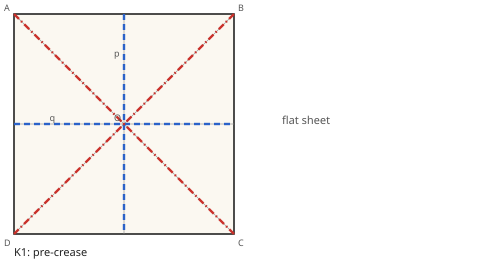

**K2. Collapse to the preliminary base.** One coupled motion at O (D10): O-m1, O-m2, O-m3, O-m4 V
180, O-B and O-D M 180, O-A and O-C F 0. Four layers. Rigid. 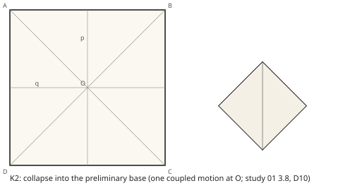

**K3. Kite folds.** The front flaps' lower edges to the centre line, each a valley through the
flap's two layers: M A-p (0, 0)-(0.5, 0.2071) in QA, V p-B (0.5, 0.2071)-(1, 0) in T2; M A-q
(0, 0)-(0.2071, 0.5) in QA, V D-q (0, 1)-(0.2071, 0.5) in Tl'. Rigid. 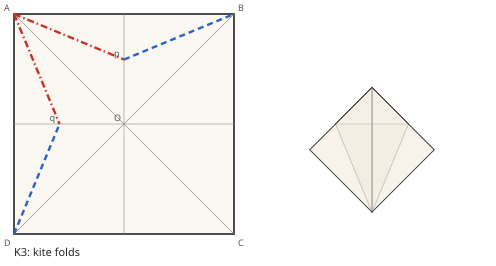

**K4. Top fold.** The top triangle down over the kite flaps on the line p-q, through three layers:
M p-q (0.5, 0.2071)-(0.2071, 0.5) in QA, V (0.5, 0.2071)-(0.6464, 0.3536) in T2, V (0.3536,
0.6464)-(0.2071, 0.5) in Tl'. The kite flaps' edges end exactly on this line (each kite flap's
image is the triangle from the bottom point to p and to the centre line at y = 0), which is why the
traditional sequence uses it. Rigid. 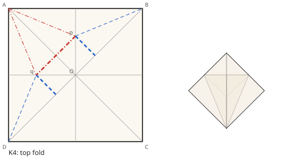

**K5. Unfold K4 and K3.** The creases stay (R7). Rigid. 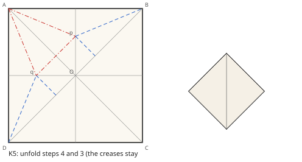

**K6. Petal fold, front.** The front layer's bottom point lifts on p-q while the sides come in on
the kite creases: M p-q 0 to 180 (the opposite sign to O-p); V A-p, A-q in QA (made M in K3, now
reversed: the sides go in under the petal); V p-B in T2, D-q in Tl' (as made in K3); p-m1 and q-m4
open from 180 to 0; O-p, O-q stay V 180. Petal (two mirrored vertices p and q, one parameter).
Layers moved: QA's lower part, T2's and Tl''s edge triangles. Rigid (`petal.ts`).
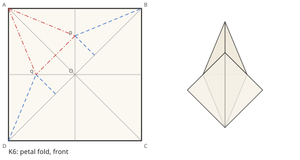

**K7. Turn over.** A view step. 

**K8. Kite and top folds behind, unfolded.** K3 to K5 on the back: M C-pC, C-qC in QC, V B-qC in
Tr, V D-pC in T7, M pC-qC (0.5, 0.7929)-(0.7929, 0.5) in QC, V (0.6464, 0.3536)-(0.7929, 0.5) in Tr,
V (0.5, 0.7929)-(0.3536, 0.6464) in T7. Rigid. 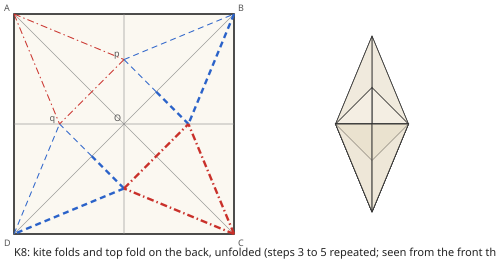

**K9. Petal fold, back: the bird base.** As K6 on QC. The bird base: 16 folded creases (the four
inner midlines O-p, O-q, O-pC, O-qC, the diagonal B-D, the petal lines p-q and pC-qC, the eight kite
creases), interior vertices O (degree 6) and p, q, pC, qC (degree 4); the diagonal A-C, the outer
midlines and quadrants B and D's petal lines are pre-creases left flat. 12 faces. In the image (y
up) the petal tips A and C are at (0, 0.5), the leg tips B and D at (0, -0.5), the widest points
p, q, pC, qC at (+-0.2071, 0). Rigid. 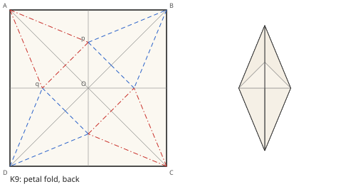

**K10. Narrowing folds.** Each leg's outer edge to the centre line, on the line from the leg's tip
at 11.25 degrees to the centre line (axiom 3: the bisector of the edge and the centre line); it
meets y = 0 at x = 0.0995. Front right, through the four layers around p: M (0.3244, 0.1344)-(1, 0)
in WAB, V (1, 0)-(0.5, 0.3341) in LB1, V (0.3244, 0.1344)-(0.4239, 0.2832) in PA, M (0.5, 0.3341)-
(0.4239, 0.2832) in TA. Front left mirrored (WDA, LD1, PA, TA), and the back two (WBC, LB2, PC, TC;
WCD, LD2, PC, TC): 16 segments. Valley through a stack. Rigid. 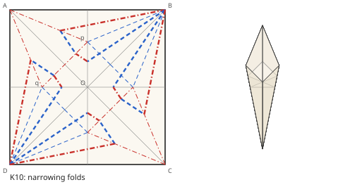

**K11. Neck and tail.** Each leg inside reverse folded up, on the line through (0, -0.05) at 15
degrees below the horizontal, so the leg turns from straight down to 60 degrees above the
horizontal. Through the leg's eight layers (WAB, LB1, LB2, WBC and their narrowed slivers): for the
neck, V (0.5728, 0.0850)-(0.55, 0) in WAB, M (0.5843, 0.1722)-(0.5728, 0.0850) in its sliver, M
(0.6378, 0.2420)-(0.6818, 0.3182) in LB1, V in LB1's sliver, M (0.6818, 0.3182)-(0.7580, 0.3622) in
LB2, V in its sliver, V (0.9150, 0.4272)-(1, 0.45) in WBC, M in its sliver; the tail mirrored: 16
segments. The leg's spine (the diagonal B-D, folded) gets the reverse vertex at (0.6818, 0.3182)
and (0.3182, 0.6818). Inside reverse fold. **Not rigid** (`reverse.ts`): the spine from the reverse
vertex runs to O without another vertex, so the relaxed path of D21 opens the leg flap and, through
O, more of the model; doc 10 measures how much. 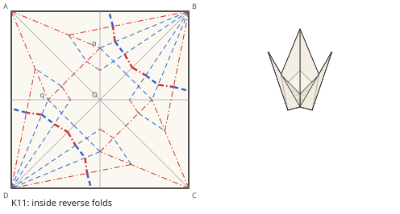

**K12. Head.** The neck's tip (at (0.2250, 0.3397) in the image) inside reverse folded down 0.1
from the tip, on a line at 15 degrees, so the head points 30 degrees below the horizontal: 8
segments in the neck's four layers and slivers near corner B, from (0.9166, 0.0166)-(0.9, 0) in WAB
to (0.9834, 0.0834)-(1, 0.1) in WBC. Inside reverse fold. **Not rigid**, as K11, with a shorter
spine (it runs to K11's vertex). 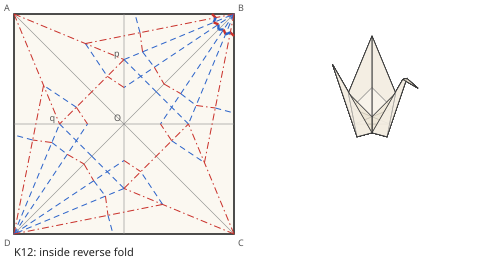

**K13. Wings.** Each wing down on the line y = 0.1 in the image, through all its layers (PA, WAB,
WDA and their slivers in front, toward the viewer; PC, WBC, WCD behind, away): V (0.3672,
0.1985)-(0.1985, 0.3672) in PA, M (0.4, 0.1193)-(0.4, 0) in WAB, and so on, 14 segments. Valley
through a stack. Rigid. The finished crane holds the wings near 90 degrees: the model's last pose
is not a flat rest state, which D1 asks of every rest state; D19 lets a model's finishing steps hold
an angle, and that needs D1's owner to agree (doc 09). 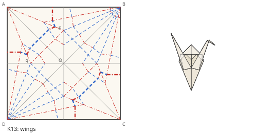

## 7. The library's models, scoped

The first list, traditional models only (no credited designer, so free to encode in an MIT repo;
section 9), with the base each starts from, the moves it adds, what it needs beyond the crane, and
a verdict, is the table in `05-model-sources.md`. The order for doc 14, by what each adds to the
engine:

1. **Fox face**: valley folds through layers only (D22 alone).
2. **Cup**: through-folds and a tuck into a pocket (D22's layer selection: one layer of two).
3. **Swan**: the kite base and outside reverse folds (D21's relaxed path on a flap with its spine
   free at the end).
4. **Fish**: the fish base, rabbit ears (degree-4, rigid, `degree4.ts`).
5. **Flapping bird**: the bird base (petals, rigid) and two reverse folds; the crane without the
   narrowing.
6. **Crane**: narrowing and three reverse folds (doc 13).
7. **Frog**: squash folds on all four flaps of the preliminary, petal folds (the frog base),
   narrowing on eight flaps, reverse folds for the legs.
8. **Lily**: the frog base, petals pulled down; it stops before the petals are curled (a curl is a
   bend, D1).

Later or out: the **paper boat** (its last steps pull the hat inside out, an opening of every layer
D21 would show as the whole model opening), the **tulip** (inflated, and its stem is a second
sheet), the **penguin** (traditional versions exist but no source read this session confirms which;
in once one is), the **jumping frog** (out: it "first appeared in" Lewis and Oppenheimer, 1963,
which "may possibly have" originated it, origamiheaven.com, read 2026-11-08; not anonymous, and its
jump is the paper's spring), and every model that needs a sink (study 01, 3.11: many vertices, out
of scope).

## 8. How a fold is encoded

**The symbols** (Wikipedia, Yoshizawa-Randlett system, read 2026-11-08; the system from
Yoshizawa's 1954 *Atarashi Origami Geijutsu*, extended by Randlett and Harbin): a thick line is the
paper's edge; dashed is a valley ("folds toward you"); dash-dot a mountain ("folds away"); thin an
existing crease; dotted a hidden edge or an x-ray line. A curved arrow shows the direction, a solid
head a valley, an open head a mountain; fold-and-unfold is one arrow with both kinds of head; turn
over, rotate and zoom have their own symbols. The operations named: pleat (alternating folds), crimp
(inside and outside), reverse fold (inside and outside, "often for feet or bird heads"), sink (open
and closed), squash (shown on a waterbomb base's flap), rabbit ear (a reference crease then two
radial folds, the flap folded down), petal ("equivalent to two side-by-side rabbit ears"), swivel,
spread squash, twist and unsink. Bases: blintz, kite, fish, waterbomb, preliminary, bird, frog,
stretched bird.

**The axioms** (Wikipedia, Huzita-Hatori axioms, read 2026-11-08), the seven ways one fold line is
defined from points and lines already on the paper:

1. through two points p1, p2;
2. placing p1 onto p2;
3. placing line l1 onto l2 (up to two solutions, the bisectors);
4. through p1, perpendicular to l1;
5. placing p1 onto l1, through p2 (0, 1 or 2 solutions);
6. placing p1 onto l1 and p2 onto l2 (0 to 3; a cubic, Beloch 1936);
7. placing p onto l1, perpendicular to l2.

Axioms 1 to 6 are credited to Justin (1986) and Huzita (1991); 7 to Justin and Hatori, and Lang
showed the list complete (same source). Rabbit Ear implements them as `axiom1` to `axiom7` in
`src/axioms/axioms.js` (read 2026-11-08), each taking points and lines `{vector, origin}` and
returning an array of lines (empty for no solution; up to 2 for 3 and 5, up to 3 for 6), with
`validate.js` keeping only solutions inside the paper.

**FOLD 1.2** (section 3): frames and the "diagrams" class, no step vocabulary. **ORIPA**
(github.com/oripa/oripa, GPL-3.0, README read 2026-11-08): a crease-pattern editor that computes
the folded shape from the pattern; `.opx` is a `java.beans.XMLEncoder` serialization of a `DataSet`
of lines `{x0, y0, x1, y1, type}` (`ExporterXML.java`, `OriLineProxy.java`), and `.cp` is plain text,
one crease per line, `type x0 y0 x1 y1` (`LoaderCP.java`), types 1 border or cut, 2 mountain, 3
valley (as Rabbit Ear's `opxToFold.js` and its `bird-base.cp` fixture read them). Patterns, not
steps. **Rabbit Ear** has a working `flatFold` and `simpleFold` (section 5) and, in
`src/graph/fold/reverseFold.js` and `squashFold.js`, stubs that log "DO NOT USE" (read
2026-11-08): no library found does a reverse, squash or petal fold. Its companion
`origami-diagrams` (github.com/amkraft/origami-diagrams, readme read 2026-11-08, last pushed 2019,
no licence listed) annotates FOLD frames under a `re:` namespace (`re:diagrams` per step,
`re:diagram_lines`, `re:diagram_arrows`, `re:diagram_instructions` by language, `re:diagram_step`
labels such as "3a") for drawing diagrams; it describes pictures of steps, not the moves that make
them.

**Existing step scripts.** A search of GitHub repositories (api.github.com/search, "origami
notation", "origami diagram", read 2026-11-08) found diagram drawing tools (an Inkscape extension, a
Blender add-on, cpToDiagrams and a few others; none defines a language) and one step language:
`yanda-dy/origami-dsl` (README read 2026-11-08), an OCaml-embedded course project with named
corners (`corner "nw" NW`), intersections and the seven axioms as `o1` to `o7`, single folds on a
square only, no layers, no moves. Nothing found encodes moves through layers on named landmarks;
orkami's notation is new.

**What doc 12 takes from each:**

- From Yoshizawa-Randlett: the move vocabulary and its meanings, word for word: valley, mountain,
  fold-and-unfold, turn over, rotate, inside and outside reverse, squash, petal, rabbit ear, pleat,
  crimp (sink named, refused). A step reads like a diagram's caption.
- From Huzita-Hatori: fold lines defined by an axiom over landmarks, never by raw coordinates in a
  traditional model. The crane needs axioms 1 (K1's diagonals: through two corners), 2 (K1's
  midlines: corner onto corner), 3 (K3's kite folds and K10's narrowing: an edge onto the centre
  line) and, for the taste steps (K11 to K13), a line through a landmark at a stated angle to
  another line, which is axiom 1 through a constructed point. Raw coordinates stay an escape hatch,
  flagged, for imported patterns.
- Landmarks: corners A to D, edge midpoints, the centre, intersections of existing creases, points
  where a crease meets an edge, named flaps (by the corner at their tip) and named layers (the
  front n, a flap's own layers), all resolved in the folded image of the step they are used in,
  then mapped to the sheet (section 5).
- From FOLD: the export (one creasePattern key frame, one inheriting foldedForm frame per step,
  file_classes "diagrams"), so a model opens in any FOLD viewer step by step.
- From Rabbit Ear: the through-fold algorithm, read not copied (D8), and the shape of an axiom's
  answer (an array, possibly empty: a step whose axiom has no solution is an error, one with two
  names which by a landmark).
- Every step reversible: the unfold is the same script played back; no step may depend on a state
  it cannot reach backwards from.
- The script compiles to doc 09's model (D19): one crease pattern, one target set per step.

Drafted as **D23**.

## 9. Sources and rights

Two kinds of source: step-by-step tutorials (origami.guide, the Origami Resource Center, Gilad's
Origami Page) give the order of steps and how a step reads to a person, as photos and diagrams with
no data; crease-pattern collections (Origami Simulator's assets, Rabbit Ear's fixtures, ORIPA files)
give geometry. Both are references. The list, what each says about its own terms, and the rule are
in `05-model-sources.md`. The rule in one line: a traditional model (anonymous, marked Traditional
by a source) is encoded in our own words and our own geometry, computed here; a credited
designer's model is not encoded without the designer's written permission; no photo, diagram,
caption or crease-pattern file is copied, and only facts (a step's order, a crease's line) are
taken.

## Open questions for docs 09 to 14

- **Q1 (doc 10).** How far does the relaxed path of the crane's neck and tail open the model (the
  leg's spine runs to O)? If it reaches the wings, does it read as paper, or does D21's fallback
  (a budgeted fan, with D1 amended) earn its place?
- **Q2 (doc 11).** Collisions along the petal path (R6), and the squash fold's rigidity, before the
  frog.
- **Q3 (doc 09).** A model's finishing steps hold creases at angles other than 0 and 180 (the
  crane's wings): D1's rest states need the owner's amendment for models.
- **Q4 (doc 13).** The taste proportions of K11 to K13 against a traditional reference (the
  Origami Simulator `traditionalCrane.svg`, MIT, as a check, not a copy).

## Scripts

| script | what it settles | run |
|---|---|---|
| `scripts/vertex-lib.ts` | loop closure, Gauss-Newton, null space, pseudo-arclength `trace`, multi-vertex `walk` | (library) |
| `scripts/degree4.ts` | a flat-foldable degree-4 vertex folds rigidly, two branches meeting only at flat | `node docs/study/scripts/degree4.ts` |
| `scripts/petal.ts` | the kite, top and petal folds at p are rigid, one parameter each | `node docs/study/scripts/petal.ts` |
| `scripts/reverse.ts` | a reverse fold on a held flap is locked; auxiliary creases do not free it cheaply | `node docs/study/scripts/reverse.ts` |
| `scripts/crane.ts` | the crane's steps as through-folds: creases per layer, assignments, base states checked, K-sketches | `node docs/study/scripts/crane.ts` |

## Sources

Read 2026-11-08 (URLs in full in `05-model-sources.md`):

- FOLD spec 1.2, raw.githubusercontent.com/edemaine/fold/main/doc/spec.md; the repo's licence (MIT)
  and `examples/` (no crane, no bird base) via the GitHub API.
- Tachi, "Simulation of Rigid Origami", Origami4 (2009), draft PDF at
  origami.c.u-tokyo.ac.jp/~tachi/cg/SimulationOfRigidOrigami_tachi_4OSME.pdf: fetched, its text not
  extractable this session; the constraint and the DOF count are quoted from search summaries of it
  and of Tachi's thick-origami paper (5OSME) on the same page. tsg.ne.jp/TT/software/ (Rigid Origami
  Simulator 0.09, proprietary).
- Ku and Demaine, "Folding Flat Crease Patterns with Thick Materials", J. Mechanisms and Robotics
  2016, arxiv.org/abs/1601.05747 (abstract; the bird base's rigidity from a search summary of the
  PDF). Abel et al., "Rigid Origami Vertices: Conditions and Forcing Sets", JoCG 2016, and Akitaya
  et al., "Rigid Foldability is NP-hard", JoCG 2020, abstract pages on erikdemaine.org.
- Wikipedia: Rigid origami ("the number of standard origami bases that can be folded using rigid
  origami is restricted by its rules"), Yoshizawa-Randlett system, Huzita-Hatori axioms, Orizuru,
  Origami ("Ethics and copyright"), Action origami.
- origamisimulator.org (compliant simulation; the SVG colour and opacity convention) and
  github.com/amandaghassaei/OrigamiSimulator `assets/` via the GitHub API (MIT).
- github.com/rabbit-ear/rabbit-ear (GPL-3.0): `src/axioms/axioms.js`, `src/graph/fold/flatFold.js`,
  `simpleFold.js`, `reverseFold.js`, `squashFold.js`, `src/convert/opxToFold.js`, the test fixture
  tree. rabbitear.org did not answer (TLS error).
- github.com/oripa/oripa (GPL-3.0): README, `ExporterXML.java`, `DataSet.java`, `OriLineProxy.java`,
  `LoaderCP.java`.
- github.com/amkraft/origami-diagrams readme; github.com/yanda-dy/origami-dsl README.
- origami.guide (the crane's steps, its about page), origami-resource-center.com,
  giladorigami.com, origamiheaven.com (the jumping frog's history), langorigami.com/copyright.

Not read: the bodies of the Tachi, Ku-Demaine and Origami Simulator papers (PDFs not extractable
here); every number this study relies on is the scripts', not the papers'.
